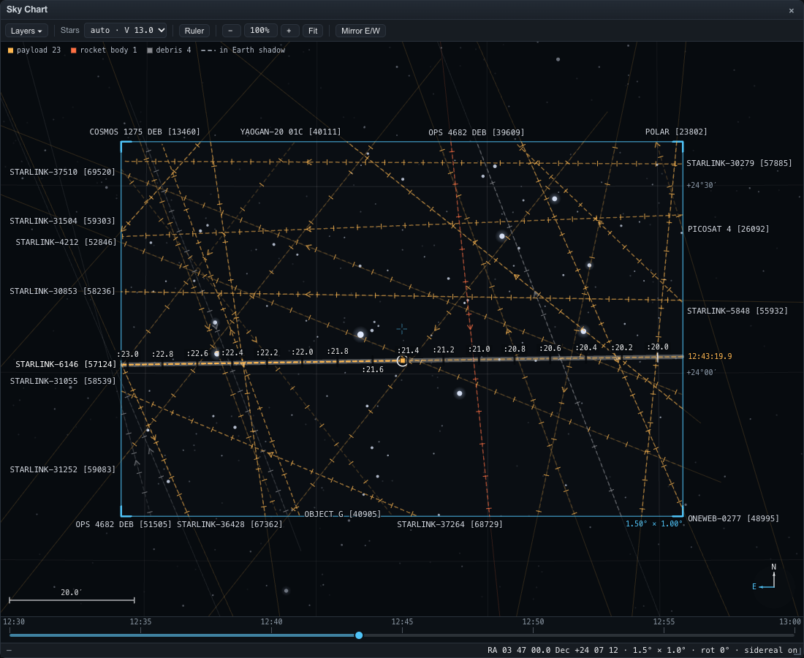
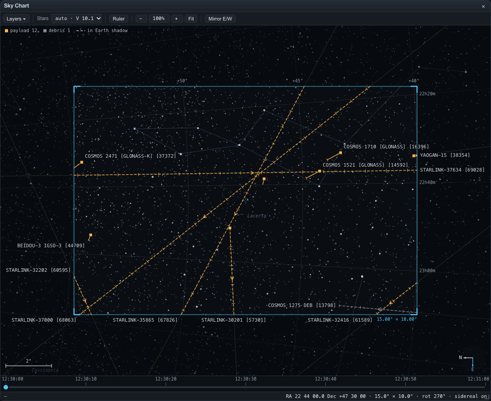

# SatIdentifier

The inverse of a satellite tracker. Instead of asking *where is this satellite*, it
asks **who is in my field of view** — so an unidentified trail on a frame can be
matched against the catalogue.

Give it a site, an epoch and a timespan, a pointing (RA/Dec J2000, Alt/Az, or LVLH
angles from orbit) and a field of view. It finds every catalogued object that
crosses that field and draws each trail on a gnomonic sky chart over a real star
background, directly comparable against your frame.

The site itself can be a **satellite** (space-based SSA): pick any object in the
loaded catalogue by NORAD number and the scan runs from *its* sensor — who crosses
my field, seen from orbit.


Local Python backend (catalogue fetching, caching, persistence — standard library
only) + browser frontend (SGP4 in Web Workers, canvas chart). Companion to
[SatObserver-MX](../satobserver), sharing its architecture and its house style.

Module APIs are in [CONTRACT.md](CONTRACT.md); how it was built and what was
measured is in [DEVLOG.md](DEVLOG.md).

## Requirements

**Packaged app** (in `release/`) — no runtime dependencies; Python and the star
catalogue are bundled. Network access is needed for catalogue fetching (cached
data works offline). The full catalogue loads from CelesTrak with no account,
or from a free [space-track.org](https://www.space-track.org) account (saved
locally on first use).

- **macOS** (`SatIdentifier-macOS-arm64.zip`): Apple Silicon. Unsigned — first
  launch on another machine needs right-click → Open once. User data lives in
  `~/Library/Application Support/SatIdentifier/`.
- **Windows** (`SatIdentifier-windows-x64.zip`, when present): produced by CI on
  a Windows runner, **untested on real hardware** — the same caveats as
  SatObserver-MX's Windows build apply.

**To run from source** (browser mode):
- Python ≥ 3.10 — **standard library only**, no packages needed
- Any modern browser (developed against Chrome; the packaged app uses WKWebView)

**To rebuild the .app**:
`python3 -m venv .venv-build && .venv-build/bin/pip install pywebview pyinstaller`
(icon regeneration additionally needs `pillow`), then:

```sh
.venv-build/bin/pyinstaller --noconfirm --clean --windowed \
  --name "SatIdentifier" --icon build_icon/SatIdentifier.icns \
  --add-data "app:app" --osx-bundle-identifier "local.satidentifier" desktop.py
```

## Run

**macOS app**: unzip `release/SatIdentifier-macOS-arm64.zip`, double-click
`SatIdentifier.app`. Native window; closing it quits.

**Dev / browser mode**:

```sh
python3 server.py
```

Starts a local server on http://127.0.0.1:8476 and opens your browser.
Options: `--port N`, `--no-browser`. Or double-click `SatIdentifier.command`.
In dev mode data lives in `./data/`.

## Workflow

1. **Catalogue** — load the full catalogue from either provider: *CelesTrak*
   (no account; assembled from nine GP queries — one per launch decade plus the
   analyst group — 6-digit objects included, and never re-requested inside
   CelesTrak's 2-hour update cycle) or *Space-Track* (full GP; free account
   required, saved locally).
   Add CelesTrak single-object queries (NORAD / COSPAR / name-contains, no
   account needed — the same tab's *Fetch SATCAT metadata* button downloads
   the SATCAT table that feeds photometry, not elements), McCants classified
   elements, or paste TLEs — everything merges into one catalogue,
   deduplicated by NORAD with the newest elements winning, and **epoch-age
   statistics are shown per source**, because stale elements are the main
   cause of a failed identification.
2. **Sites** — add your observing site and mark it active. Two kinds: **Ground**
   (lat / lon / alt) or **Orbit** (an observing satellite, picked from the loaded
   catalogue by NORAD number or name — the TLE is resolved live from the
   catalogue, so the observer can never go stale against the targets).
3. **Pointing** — start time, timespan, pointing, field of view.
4. **Crossings** — press *Scan*.
5. **Sky Chart** — compare the trails against your frame.

## The Sky Chart

The chart is built to be held against an image. The window is four stacked
parts — toolbar, chart, timeline, status line — and nothing overlaps the sky.





- **The frame is your image.** Inside it: stars and trails, nothing else.
  Object names sit *outside* the frame at each trail's end, placed so that no
  two overlap (and none lies across another trail); RA/Dec labels sit where
  each grid line leaves the frame. What does not fit is on the hover card.
- **Every trail is a clock.** Ticks mark round UTC instants — tenths of a
  second on a 2-second LEO streak, minutes on a GEO drift. Hover or click a
  trail *anywhere along its length* and the ticks are labelled, with entry and
  exit times, the rate, the position angle and the trail's length.
- **Dashed = in the Earth's shadow.** It crosses the field but reflects no
  sunlight: an optical streak is not that object.
- **Time slider.** The strip under the chart is the scan window: a UTC axis
  and a thumb for the clock. Press or drag anywhere on it to move the clock.
- **Ruler (R).** Drag along a streak: its length and position angle, and the
  predicted trails ranked by how well they match it (offset and angle).
- Wheel zooms about the cursor, drag pans, double-click re-aims, `F` fits,
  `L`/`T` toggle names/tracks, `Esc` clears. *Layers* lists every drawable
  layer by name.

## Observing from orbit (space-based SSA)

With an Orbit site active, the same pipeline answers "who crosses my sensor's
field" for a satellite-mounted instrument:

- **Az/El become LVLH angles** (labelled AzL/ElL): Az from the along-track
  (velocity) direction toward the orbit normal, El from the local horizontal
  toward zenith (radially out; −90° = nadir). The *Mount* tracking mode becomes
  **LVLH** — a body-fixed staring sensor, drifting through the stars at the
  orbital rate exactly as a parked ground mount drifts at the sidereal rate.
- **Earth-limb occlusion replaces the horizon**: a target is dropped only while
  the line of sight passes through the Earth itself, and entry/exit times resolve
  a target *rising from behind the limb* the same way they resolve a field edge.
  No refraction, ever, in orbit.
- The observer **never identifies itself**, and its own TLE error is added to the
  match tolerance — at the sensor it is indistinguishable from the target's.
- All-Sky is a ground-horizon projection and says so on an Orbit site; the Sky
  Chart works for both kinds.

A rectangular field is carried rigidly with the sensor: on an LVLH-fixed mount
the sky turns under the detector once per orbit, and the rectangle turns with it.

The soundness proofs run over orbital geometry too: the geometric cull returns
the identical crossing set with the cull disabled, the skip bound is walked
instant by instant for an LVLH pointing, and every reported position agrees with
an independent astrometric recompute to ~0.02″ (see `tools/test_scan.js`
sections [o] and [k]).

## What it computes

- **Every crossing, however brief.** The scan does not sample on a grid: it
  steps by however long the object *provably cannot* reach the field, then
  walks the field boundary itself, so a LEO object that crosses a 0.2° field in
  a quarter of a second is found as surely as a GEO drift — checked against an
  exhaustive brute force (`tools/test_scan.js` section [r]). Entry and exit are
  good to 10 ms.
- **Crossings**: entry / closest-approach / exit times, separation, RA/Dec (J2000),
  Az/El, range, range rate, angular rate and position angle, estimated magnitude,
  sunlit/penumbra/umbra, orbit class, TLE age.
- **Two angular rates**, because which one streaks your exposure depends on how you
  were tracking. Against the **stars** (`d(RA,Dec)/dt`) is the streak on a
  sidereally-guided frame — note a geostationary object is *not* stationary here, it
  drifts at ~15″/s, which is why GEO streaks in tracked images. Against the
  **horizon** (`d(alt,az)/dt`) is what a parked mount sees, where GEO is a fixed dot
  and the stars trail instead — on an Orbit site this second rate is measured
  against the LVLH frame, i.e. what a body-fixed staring sensor records. The chart
  draws whichever matches your tracking mode, including the field rotation a parked
  mount sees, and the trail drawn across the field between entry and exit is the
  thing to hold up against your frame.
- **Star background** (Gaia DR3): the depth adapts to the field so that the
  chart shows about the same number of stars — a few thousand — at any scale:
  **V = 13** on views up to 8° across, V 12 at 12°, V 10 at 30°, V 8.6 at 60°.
  A local tiled database to V 13 serves views narrower than 26° (built once
  with `python3 tools/make_starcat.py --deep-tiles`, ~60 MB, never touches the
  network at runtime); wider views use the bundled catalogue (V ≤ 10.5,
  549 037 stars). In the Milky Way the brightest 12 000 stars are kept and the
  *Stars* control shows the depth that resulted. The deep build is
  **optional**: out of the box, without it, every field draws from the bundled
  catalogue and simply tops out at **V = 10.5**. Positions are at the current
  epoch (proper motions applied) — including the brightest stars, which Gaia
  does not contain and which are placed from Hipparcos (≤ 0.2″; before round
  23 they sat up to an arcminute off). Star dots follow Stellarium's rendering
  law, fading smoothly to invisibility at the limit, with a soft halo under the
  bright ones. **On a parked mount the stars trail** over the exposure, as they
  do in the frame, while a geostationary object stays a dot. Hovering a star
  shows its V magnitude; the *Stars* control shows the depth actually drawn.
  Sun/Moon (with lunar phase), constellation overlays, satellite labels and
  satellite tracks each have a toolbar toggle; the All-Sky panel uses the
  bright-star set (V ≤ 4.6) and carries the Milky-Way glow. No twilight or
  daylight tinting in either view.

## Accuracy — read this before trusting an identification

Frame handling is deliberately careful, because the tool compares satellite positions
against a star field:

- Coordinates are **J2000 mean equinox**. SGP4 returns TEME, which is *not* J2000 —
  precession since J2000 is **0.36° in 2026**, twenty times a typical telescope field.
  The full TEME → J2000 rotation (IAU-1976 precession, IAU-1980 nutation, equation of
  the equinoxes) is applied. Verified against satellite.js's own alt/az path over 1102
  samples spanning LEO/HEO/GEO and four sites: agreement **1.4e-5 arcsec**.
- Refraction is always applied to Alt/Az (1.7′ at El 30°, 5.4′ at El 10°), and the
  inverse is solved by iteration so mode switching is exactly reversible.

**But the frames are not the limiting error — the elements are:**

| Term | Magnitude | Applied? |
|---|---|---|
| TLE position error (fresh → a week old) | ~1–20 km ⇒ **7′–2°** at 500 km range | irreducible |
| UT1−UTC ignored by default | ≤ 0.9 s ⇒ **≤ 2.9′** | optional `DUT1` setting |
| Refraction | 1.7′ at El 30°, 5.4′ at El 10° | always applied |
| Annual aberration | ≤ 20.5″ | no — see below |
| Light time | 5″ LEO, 2″ GEO | **yes** — positions are astrometric |
| Annual / orbital aberration | ≤ 20.5″ / ≤ 5″ | no — see below |
| Precession + nutation | < 1″ | **yes** |

Positions are **astrometric**: the satellite is placed where it was when the light
left it, and aberration is applied to neither satellites nor stars — it displaces a
satellite and the stars around it alike, so the chart and the objects stay mutually
consistent, and this is the place a plate solution against catalogue stars measures.
A target is in the field only while it is above the horizon (ground) or clear of the
Earth's limb (orbit). TLE age
is shown per row and in Satellite Info, because it is the number that decides whether
an identification is believable.

**Magnitudes are estimates, and mostly priors.** The method is shown per row:

| Method | Meaning |
|---|---|
| `qsmag` | McCants standard magnitude — a real observed value |
| `rcs` | Diffuse sphere from the SATCAT radar cross-section |
| `model` | Documented constellation brightness (Starlink, OneWeb) |
| `type` | Size class from SATCAT object type (R/B ≫ PAY ≫ DEB) |
| `default` | 1 m sphere. A guess, flagged as one |

Two data facts make the lower tiers necessary rather than optional: **CelesTrak
publishes no RCS above NORAD 50000** (measured: 41–97% coverage below 40000, 25.6% for
40000–49999, 0.0% above 50000), and **mmccants.org/programs/qsmag.zip currently
returns HTTP 404**. On a modern catalogue most objects therefore land on a prior with
a magnitude or more of real scatter. Do not read the magnitude column as photometry.

## Repository layout

```
server.py                  Python 3 stdlib-only backend: static files + JSON API
desktop.py                 pywebview shell for a native window
SatIdentifier.command      double-click launcher (dev mode)
app/
  index.html               loads CSS + scripts in a fixed order
  css/app.css              the whole design system, dark theme
  assets/stars_deep.bin    Gaia DR3 to V=10.5, 549 037 stars, 5.5 MB (preferred)
  assets/stars_m9.bin      Tycho-2 to V=9.0, 130 183 stars, 1.3 MB (fallback)
  js/frames.js             coordinate frames, precession/nutation, refraction, TAN
  js/propagate.js          SGP4 wrapper and the topocentric solution
  js/scan.js               worker pool, merge, budgeting
  js/worker/scan-worker.js the three-stage scan engine (cull, skip-sweep, boundary walk)
  js/stars.js              deep star catalogue, cone queries
  js/photometry.js         five-tier magnitude model, Earth shadow
  js/chart.js              gnomonic sky chart, timeline, ruler (main view)
  js/crossings.js          crossings table (main list)
  js/pointing.js           the input window
  js/allsky.js             all-sky context view with the FOV footprint
  js/state.js  util.js  clock.js  windows.js  sources.js  locations.js  satinfo.js
tools/
  make_starcat.py          builds the star catalogue asset; --deep-tiles builds
                           the local V=13 tile set into data/deepstars/ (gitignored)
                           --refine-bright repairs bright-star positions in place
  test_*.js                verification harnesses — see DEVLOG
docs/                      screenshot
data/                      state, caches, credentials, deep star tiles (gitignored)
```

## Credits

Propagation: [satellite.js](https://github.com/shashwatak/satellite-js) (SGP4/SDP4).
Stars: Gaia DR3 (Gaia Collaboration 2022) and Tycho-2 (Hog+ 2000) via VizieR, plus
BSC5/HYG bright-star photometry by way of
[d3-celestial](https://github.com/ofrohn/d3-celestial). Catalogue data: CelesTrak,
Space-Track, Mike McCants. The scan's structure — hoisting SGP4 init out of the time
loop, rotating the pointing rather than the catalogue, and gating expensive work
behind a cheap scalar test — is taken from Bill Gray's
[sat_code](https://github.com/Bill-Gray/sat_code); the precession handling follows the
reasoning in his `lunar/precess.cpp`. Problem framing owes a debt to
[SatSkyMap](https://github.com/lnicastro/SatSkyMap).
